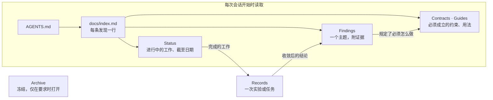

# project-docs

**写项目的收敛态，而不是走到这里的路径。**

`project-docs` 做的是项目级记忆管理：把属于某个项目的事实（接口不变量、实验结论、当前进展与
阻塞）沉淀为随代码演进、原地重写的仓库文档，让 Agent 在这个项目里工作得更自如，而不替代、也
不试图管理一台机器上的全部记忆。

它由一个 Agent 技能（[`SKILL.md`](skills/project-docs/SKILL.md)）和一个检查少数结构规则的
`project-docs` 命令行工具组成，后者也可以作为 Claude Code hook 运行；技能承担主要工作，linter
只是安全网。[English README](README.md)

## 项目记忆 vs. 全局记忆

我们有意不把项目事实放进全局 Agent 记忆，因为在我们看来，全局记忆越积越容易冗余、互相冲突；
越贴合某个项目的经验，放进全局后越容易干扰其他任务，也越难泛化。所以我们让全局记忆只放跨项目的
协作偏好和指针，项目事实留在项目自己的仓库里。

## 核心规则

- 讨论或实验收敛之后再写结论，不写得出结论的过程。
- 原地重写受影响的文字，删除被取代的说法，每个事实只在一处出现。
- 状态页不超过一屏：进行中的工作、截至日期与信息来源、下一步、阻塞项。
- 每条发现按主题命名，并在文档索引中列为 `主题 - 一句话结论`。
- 入口文档（AGENTS.md、文档索引、状态页）不链接归档文件；归档文件第一行是“历史记录，
  非当前指导”的说明。

```markdown
<!-- 追加式：每个读者都得自己判断哪一行仍然成立 -->
哈希表负载必须低于 0.85。
Update (2026-11-12)：0.85 在街景上卡顿，改用 0.70。

<!-- 原地重写：只写当前事实，并链接证据 -->
哈希表占用率不超过 0.70（[负载因子](findings/voxel-hashing.md)）。
```

各类文档之间的关系：



## 安装

技能可以用 `npx skills add mq-yuan/project-docs -g` 安装，也可以手动复制：

```bash
git clone https://github.com/mq-yuan/project-docs.git
mkdir -p ~/.agents/skills ~/.claude/skills
cp -R project-docs/skills/project-docs ~/.agents/skills/
cp -R project-docs/skills/project-docs ~/.claude/skills/
```

命令行工具需要 Python 3.11+，没有运行时依赖。它目前未发布到 PyPI：请从 GitHub 安装或运行，
并固定到发布 tag；切勿不带 `--from` 裸跑 `uvx project-docs` 或 `uvx pdocs`（要么失败，要么拉到
PyPI 上无关的同名包）。

```bash
uvx --from git+https://github.com/mq-yuan/project-docs@v0.1.0 project-docs check
uv tool install git+https://github.com/mq-yuan/project-docs@v0.1.0   # 提供 project-docs 与 pdocs
```

## 用法

```text
project-docs check [PATH] [--format text|json]   检查仓库（默认 .）
project-docs map [PATH]                          列出发现的文档及其类型
project-docs init [PATH] [--force]               生成 .project-docs.toml、docs/index.md、docs/status.md
project-docs hook                                Claude Code PostToolUse hook（读取 stdin）
退出码：0 通过，1 发现问题，2 hook 反馈，3 用法、配置或 IO 错误
```

linter 读取仓库根的 `AGENTS.md`、`CLAUDE.md`、`CLAUDE.local.md`、`README*.md`、`.claude/CLAUDE.md`、
`docs/` 和 `[paths]` 匹配的文件。类型先取 `[paths]`，再按 [`examples/3d-recon-docs/`](examples/3d-recon-docs/)
所示的固定 `docs/` 布局（`index.md`、`status.md`、`contracts/`、`guides/`、`records/`、`findings/`、
`archive/`）判定。嵌套仓库整棵跳过；`docs/` 本身是嵌套仓库或软链时同样跳过；站点生成器的源目录
（Docusaurus、Jekyll 等）请用 `exclude` 排除。

## 规则

所有规则都是错误级别，只做结构判定，与文档语言无关；拿不准的情况不报。

| 规则 | 检查内容 |
| --- | --- |
| PD000 | 每个被发现的 Markdown 文件都能按 UTF-8 读取。 |
| PD001 | 入口文档、文档索引和状态页不链接归档文件（`[x](y)`、`[x]: y`、`<a href>` 或 `@path`）；可以链接归档索引。 |
| PD002 | 归档文件（归档索引除外）第一个非空行以 `>` 开头。 |
| PD003 | 状态页非空行不超过 `status_max_lines`（默认 60）。 |
| PD004 | 状态页包含一个合法、且不晚于明天的 `YYYY-MM-DD` 日期。 |
| PD007 | 每条发现都被文档索引链接（列表项、表格行或任意行），并带有结论：该行除链接外有字词字符，或紧随其后的缩进续行有字词字符。 |
| PD009 | 非归档文档中的相对链接指向存在的路径。不检查锚点；仓库外的目标、被仓库 `.gitignore` 忽略（按文件或目录）的目标、git 无法判定（如位于未检出的 submodule 内）的目标跳过。 |

## 配置

配置放在仓库根：`.project-docs.toml`，或 `pyproject.toml` 的 `[tool.project-docs]`。两者同时
存在时以 `.project-docs.toml` 为准。出现未知键或值类型错误时以退出码 3 结束。

```toml
status_max_lines = 60                 # 状态页非空行上限
exclude = ["experiments/scratch/**"]  # 要跳过的文件和目录

[paths]  # index, status, contract, guide, record, finding, archive, archive_index
status = "STATUS.md"
finding = ["notes/findings/**"]
```

## Claude Code hook

在 `.claude/settings.json` 或 `~/.claude/settings.json` 中加入：

```json
{"hooks": {"PostToolUse": [
  {"matcher": "Edit|Write", "hooks": [{"type": "command", "command": "project-docs hook"}]}
]}}
```

hook 只在有配置文件的仓库中生效（`project-docs init` 会生成），并且只报告刚被编辑的文件中的
问题，以退出码 2 结束，让 Claude Code 把问题反馈给 Agent。根目录是启动 Claude Code 会话的目录
（`$CLAUDE_PROJECT_DIR`），配置放在那里。hook 需要 `project-docs` 在 `PATH` 上（`uv tool install`）。

## 与 ADR 的关系

架构决策记录（ADR）为每个决策保留一份不可修改的文件。project-docs 按生命周期拆分 ADR 里的内容，
让默认阅读路径上只有今天仍然成立的事实：

| ADR 中的内容 | 在 project-docs 中 |
| --- | --- |
| 决策本身 | Contract，设计变化时重写，附一句理由 |
| 选 A 不选 B 的证据 | 各条 Record，以及它们支撑的主题 Finding |
| 提议中或进行中的工作 | Status 和进行中的 Record |
| 被取代的决策 | 需要保留历史时放进 Archive，否则交给 git |

project-docs 不维护按编号、按时间排列的决策日志。需要这种日志的团队，可以把 ADR 当作已冻结的
决策记录与这些文档并存，更细的背景写在 commit message 或 PR 描述里。

## 背景与延伸阅读

- *Can Agent Memory Systems Track Evolving State?*（StateMemBench，[arXiv:2608.19652](https://arxiv.org/abs/2608.19652)）：
  记忆系统难以跟踪已被取代的状态。
- *Filesystem-Based Memory for LLM Agents: Organization, Evolution, and Sustainability*（[arXiv:2607.26637](https://arxiv.org/abs/2607.26637)）：
  由 Agent 维护的文件系统记忆，其组织结构会随时间侵蚀，只有最强的管理 Agent 例外。
- *Skill-V: Verifiable Self-Evolving Skill Library for Interactive Agents*（[arXiv:2610.11781](https://arxiv.org/abs/2610.11781)）：
  技能库需要明确且可验证的适用边界。
- *Scaling Test-Time Compute for Agentic Coding*（COLM 2026，[arXiv:2604.16529](https://arxiv.org/abs/2604.16529)）：
  把完成的 rollout 压缩成结构化摘要后再复用。

MIT 许可证，见 [LICENSE](LICENSE)。社区交流：[LINUX DO](https://linux.do)。
